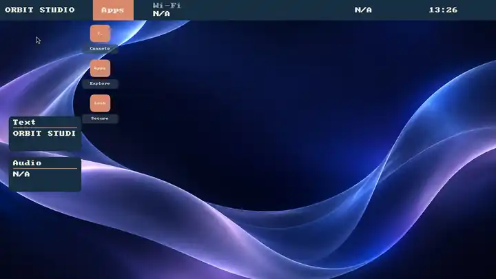

<div align="center">


# RiceBowl

**Build a desktop, not just a theme.**

A modular Linux desktop project with seven OS-inspired styles, an experimental Wayland environment and tools for building your own rices.

[XFCE gallery](screenshots/current/README.md) · **[Wayland progress & screenshots](WAYLAND_PROGRESS.md)** · [Desktop status](DESKTOP_ENVIRONMENT_STATUS.md) · [Roadmap](RICEBOWL_DE_ROADMAP.md)

</div>


## What it includes

- **Seven XFCE/X11 styles:** Windows 98, XP Luna, Windows 7, Windows 10, Frutiger Aero, ChromeOS and macOS-inspired desktops.
- **Opt-in Wayland preview:** labwc with the native Rust RicePlate panel, menus, desktop shortcuts, live status controls and reversible rice switching.
- **RiceSpice and RicePop:** desktop settings, network/audio controls, notifications and on-screen displays.
- **RiceClip and RiceShot (experimental):** optional RAM-only Wayland clipboard history and on-demand screenshots, integrated in the same repository.
- **Rice Creator 0.9 (experimental):** GTK recipe editor, reusable components, isolated previews and reference-image comparison with region-level feedback.
- **Rice ecosystem:** optional, validated appearance integration with [RiceField](https://github.com/CopyPasteUser/Ricefield) and [Taskotto](https://github.com/CopyPasteUser/Taskotto).

XFCE/X11 remains the default. The Wayland session and Creator are **previews**, not a finished replacement desktop or automatic screenshot-to-desktop converter. Hardware, accessibility and multi-monitor acceptance are still in progress.

## Wayland desktop · experimental preview

[](WAYLAND_PROGRESS.md)

*Orbit Studio — actual headless labwc/RicePlate capture, not a concept render.*

RiceBowl's next desktop is built around **labwc + native Rust RicePlate**. It already includes a configurable taskbar, launcher, desktop shortcuts, widgets and live rice switching, plus RiceSpice settings, RicePop notifications and **Rice Creator 0.9**.

The preview is **opt-in, not stable 1.0**: real-device login, multi-monitor/HiDPI, focus, accessibility, hardware controls and performance sign-off remain open. XFCE/X11 stays the supported default.

### Optional Wayland utilities (early preview)

After installing RiceBowl, run these **inside a Wayland session**:

```bash
ricebowl riceclip open                 # explicitly enable capture and open the GTK history window
ricebowl riceclip pause                # temporarily stop adding clipboard items
ricebowl riceclip clear                # forget every captured item, including pins
ricebowl riceclip stop                 # stop all clipboard watchers and discard history
ricebowl riceshot --mode region        # select a region, save a private PNG
ricebowl riceshot --mode monitor --clipboard
ricebowl riceshot --mode full --annotate
```

RiceClip requires `wl-clipboard` (for `wl-paste --watch` and `wl-copy`) and `python3-gi`/GTK3 for its window. It starts **only when requested**, keeps a bounded history in memory and never persists it; do not use it as a secret manager. RiceShot requires `grim`, `slurp` for region/monitor selection, `wl-clipboard` for copying and optional `swappy` for annotations. PNG files are created without overwriting existing paths. Both tools also have app-menu entries after installation; they are not enabled at login.

These are software-level prototypes. Clipboard protocol availability, lock-screen privacy, multi-monitor screenshots, scaling, focus, accessibility and actual labwc hardware acceptance remain open; see the [roadmap](RICEBOWL_DE_ROADMAP.md).

**[See four real Wayland screenshots and detailed progress →](WAYLAND_PROGRESS.md)** · [Screenshot gallery](screenshots/wayland/README.md)

## Try it

For Linux Mint XFCE or a compatible XFCE/X11 session:

```bash
sudo apt install -y git python3-gi python3-cairo python3-gi-cairo python3-pil gir1.2-gtk-3.0 gir1.2-wnck-3.0
git clone https://github.com/CopyPasteUser/Ricebowl.git "$HOME/RiceBowl"
cd "$HOME/RiceBowl"
bash install.sh --dry-run
bash install.sh
"$HOME/.local/bin/ricebowl"
```

Choose a style in the Hub; installation alone does not change your desktop. Run `ricebowl creator` for the experimental editor. `ricebowl update` checks for updates, and `macrice rice restore` undoes a rice switch.

## Documentation

[Wayland installation, Creator and safety](WAYLAND_SESSION.md) · [Feature and release status](DESKTOP_ENVIRONMENT_STATUS.md) · [Screenshots](screenshots/current/README.md) · [Example recipes](examples/wayland/README.md) · [Ecosystem roadmap](RICE_ECOSYSTEM_ROADMAP.md) · [Contributing](CONTRIBUTING.md) · [License](LICENSE) · [Releases](https://github.com/CopyPasteUser/Ricebowl/releases)

RiceBowl is independent of Microsoft, Apple and Google. Included artwork is original; a stable release still requires real-device acceptance.
