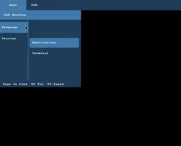

<p align="center">
  
</p>

<h1 align="center">RiceBowl on Wayland</h1>

<p align="center"><strong>A real desktop shell, built from reusable parts.</strong></p>

<p align="center">
  An experimental <strong>labwc + native Rust RicePlate</strong> desktop, with RiceSpice settings, RicePop notifications and a visual Rice Creator.
</p>

<p align="center">
  <strong>PREVIEW · OPT-IN · NOT 1.0</strong><br>
  <a href="#screenshots">Screenshots</a> · <a href="#what-works">Implementation status</a> · <a href="#try-it">Try it</a> · <a href="#whats-left-for-10">Release blockers</a>
</p>

---

## Screenshots

These are **actual native RicePlate frames captured inside labwc**, not design mockups or XFCE screenshots. The previews below are optimized WebP copies of real CI PNGs, checked into the repository so they **load directly and do not expire**. All images were captured with a *headless* compositor and simulated device state; they are **not** proof of a functioning physical desktop.

| Orbit Studio · original composition | Heritage Modern · classic composition |
| :---: | :---: |
| [](screenshots/wayland/orbit.webp) | [](screenshots/wayland/heritage.webp) |
| Upper panel, independent widget placement and custom design tokens | Lower taskbar, desktop shortcuts and an entirely different layout |

| Native desktop workspace | Sidebar launcher menu |
| :---: | :---: |
| [](screenshots/wayland/workspace.webp) | [](screenshots/wayland/menu.webp) |
| Live compositor framebuffer, not a pre-rendered design | Actual Wayland menu surface; cropped for readability |

[**Open the screenshot gallery →**](screenshots/wayland/README.md) · [**CI run and full-resolution originals →**](https://github.com/CopyPasteUser/Ricebowl/actions/runs/42625109733)

## What works

The project has moved beyond a session wrapper. The core shell and system modules exist in source, and native/headless CI exercises important rendering and lifecycle paths. **Device-level usability and stable-release readiness remain separate acceptance gates.**

| Area | Available in the experimental session | Not yet signed off |
| --- | --- | --- |
| **Session & recovery** | Separate opt-in Waybar and native RicePlate labwc login choices (the latter appears with an installed native binary), nested preview, supervised processes, reversible rice selection and Waybar crash fallback | Login/relogin, crashes, suspend and recovery on actual hardware |
| **RicePlate** · Rust | Per-output taskbar and grouped windows, launcher, tab/sidebar menus, keyboard navigation, native tray/DBusMenu, calendar and desktop shortcuts; native CI checks real Wayland and XWayland terminal open/paint/close plus isolated virtual-pointer taskbar minimize/restore | Physical input/focus, real application compatibility, third-party tray menus, mixed-DPI and Orca |
| **Desktop layout** | Reflowing shortcuts, widgets and shared action/status components; bounded appearance tokens and custom artwork | Full composition flexibility and reliable physical multi-monitor interaction |
| **RiceSpice** · GTK | NetworkManager/WirePlumber/BlueZ controls; audio streams, VPN import, display trials with rollback, power, time and input/accessibility preferences | Hardware interoperability, monitor restoration and accessibility testing |
| **RicePop** | Mako-backed notification inbox, explicit actions, volume/backlight OSD | Media keys, notifications, service restarts and screen-reader behavior on devices |
| **Rice Creator 0.9** | Editable recipes, reusable parts, native isolated renders, reference-image selection and visual error comparisons; validated RicePack v4 exports; explicit reviewed install plus confirmed opt-in Wayland apply/restore | Automatic screenshot-to-rice generation, historical fidelity, physical live-switch QA and final designer UX |
| **Ecosystem** | Optional data-only RiceProfile integration with RiceField and Taskotto, guarded apply/revert | Frame-atomic changes across unrelated applications are **not** supported |

**Architecture:** labwc manages floating windows and compositing. RicePlate draws the shell and desktop surfaces. RiceSpice handles user-invoked system settings; RicePop presents notifications without replacing Mako as notification owner. Creator produces validated data, **not arbitrary executable desktop scripts**. Ordinary GTK/Qt application decorations remain owned by their toolkit/window manager.

For the complete feature contracts and caveats, see the [engineering status matrix](DESKTOP_ENVIRONMENT_STATUS.md), [Wayland session guide](WAYLAND_SESSION.md) and [canonical development roadmap](RICEBOWL_DE_ROADMAP.md).

## Try it

Keep XFCE/X11 installed and selectable. Installing ordinary RiceBowl does **not** activate the Wayland session. In an existing compatible Linux desktop, with the [documented dependencies](WAYLAND_SESSION.md#prerequisites) installed:

```bash
ricebowl de check --json
ricebowl de catalog --json
ricebowl de start --nested --panel native
```

To inspect native controls using the bundled example (importing the recipe does not activate it):

```bash
ricebowl de recipe-import --recipe "$PWD/examples/wayland/quick-controls.json"
ricebowl de start --nested --panel native --recipe quick-controls
```

For the optional separate **RiceBowl (Wayland Preview)** login entry, follow the [reviewable .deb installation steps](WAYLAND_SESSION.md#build-and-opt-in-debianubuntumint). Never replace the only working session while testing. **Real network, audio, clock and display controls can change system state even when opened from a preview.**

The native CI also builds a **separate, removable amd64 preview `.deb`** for
`riceplate-native` with reproducibility and binary-integrity checks. It is an
optional experimental component, not an auto-installed or signed 1.0 desktop.
Installing that native preview package together with the reproducible session
entry package exposes **RiceBowl (Native Wayland Preview)** in compatible login
managers. The ordinary Waybar-backed entry remains available; native session
selection never changes the XFCE default.

## Resume and session guard checkpoint (November 2026)

- Added BOOTTIME-minus-MONOTONIC resume observation to the existing
  supervision loop, with a one-shot post-wake Waybar output-layout recheck
  only when needed. No new resident daemon or interval timer.
- The mandatory swayidle guard now fails closed for full Wayland logins even
  if live RPC initialization fails or is disabled. It cannot trigger an
  unprotected native-to-Waybar fallback.
- Synthetic wake clock offsets and watcher crashes are covered by tests.
  **No physical lid, unlock, suspend cycle or mixed-DPI dock QA has been
  completed**, so this is still a preview.

## What's left for 1.0

1. **Real desktop:** verified login/logout, XWayland, portals, Flatpak integration, physical clipboard interoperability, polkit, lock and suspend/resume. Headless CI additionally checks both text clipboard directions with real Wayland/XWayland clients; MIME-rich and device-specific clipboard use remain unaccepted.
2. **Input and displays:** real multi-monitor and mixed-DPI behavior, hotplug, pointer drag, native tray/focus and Orca/AT-SPI.
3. **Device controls:** failures and restarts across Wi-Fi, audio, Bluetooth, display, notifications, media keys and backlight.
4. **Creator and switching:** visual/functional QA of two genuinely distinct rices; safe install, restore and supported RiceField/Taskotto integration.
5. **Release evidence:** current-SHA automated CI, verified installers and rollback, cold start/settled CPU and memory measurements, owner hardware sign-off.

There is **no honest percentage-complete number** yet. Tested source paths and screenshots do not substitute for physical acceptance. [Release-gate checklist](RELEASE_1_0_GATES.md) · [Full roadmap](RICEBOWL_DE_ROADMAP.md).

<details>
<summary><strong>Screenshot provenance & reproducibility</strong></summary>

All four images are downscaled WebP previews of the real PNG outputs of [Native RicePlate prototype CI #42625109733](https://github.com/CopyPasteUser/Ricebowl/actions/runs/42625109733), source commit [`8001a0a`](https://github.com/CopyPasteUser/Ricebowl/commit/8001a0a24db469358f420cc82a8ccaf4522b26c6), 9 November 2026. The CI compositor was labwc with a headless wlroots backend and pixman renderer; framebuffers were captured using `grim`.

| Committed image | Source PNG inside the original CI artifact |
| --- | --- |
| `screenshots/wayland/orbit.webp` | `creator-examples/orbit-studio-v10-1366x768-scale-1-0.png` |
| `screenshots/wayland/heritage.webp` | `creator-examples/heritage-modern-v10-1366x768-scale-1-0.png` |
| `screenshots/wayland/workspace.webp` | `isolated-v5.png` |
| `screenshots/wayland/menu.webp` | `menu-sidebar-v6.png` (cropped) |

The source CI artifact contains `capture-manifest.json` and `creator-examples/manifest.json` with source revision and source-image hashes. Those original artifacts expire after their GitHub Actions retention period; **the four committed previews do not**. Reproduce captures using [.github/workflows/riceplate-native.yml](.github/workflows/riceplate-native.yml) and [the recipe examples](examples/wayland/README.md).

</details>

---

[**RiceBowl README**](README.md) · [**All Wayland docs**](WAYLAND_SESSION.md) · [**Release status**](DESKTOP_ENVIRONMENT_STATUS.md) · [**Screenshots**](screenshots/wayland/README.md)
