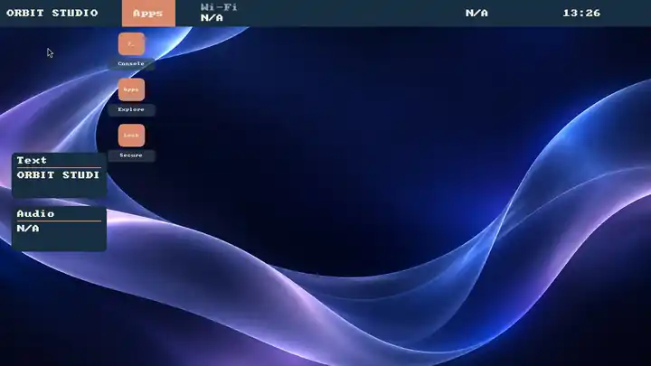
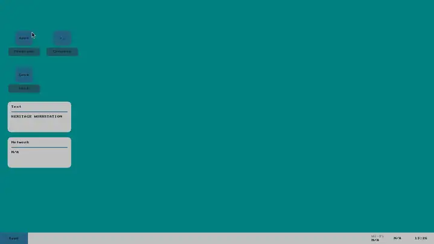

<p align="center">
  
</p>

<h1 align="center">RiceBowl on Wayland</h1>

<p align="center"><strong>A real desktop shell, built from reusable parts.</strong></p>

<p align="center">
  An experimental <strong>labwc + native Rust RicePlate</strong> desktop, with RiceSpice settings, RicePop notifications and a visual Rice Creator.
</p>

<p align="center">
  <strong>PREVIEW · OPT-IN · NOT 1.0</strong><br>
  <a href="WAYLAND.md">Wayland guide</a> · <a href="#screenshots">Screenshots</a> · <a href="#what-works">Implementation status</a> · <a href="#try-it">Try it</a> · <a href="#whats-left-for-10">Release blockers</a>
</p>

---

## Screenshots

**Luna fidelity development:** The opt-in `xp-luna-columns` renderer now has
original beveled account/header art, a clearer two-column shelf, real action
glyphs, a visible clickable Close footer, a raised green Start control and
adaptive 400×380/480×456 menu surfaces for larger logical outputs. The
Luna taskbar now also draws compact, original 16px network and speaker symbols
instead of showing wide `N/A` text cells; offline/muted states remain visibly
marked while the original accessible widget states and pointer targets remain.
Luna also opts into a bundled OFL-licensed Liberation Sans system font with
proportional glyph advances; other recipes keep their existing font behavior.
The [current Luna screenshots](screenshots/wayland/README.md#current-luna-ui--proportional-font-and-compact-tray-11-november-2026)
come from [green native CI run #43031538310](https://github.com/CopyPasteUser/Ricebowl/actions/runs/43031538310),
including output reconfiguration and fractional scale. Historical captures
in the gallery remain available for comparison. Exact XP-era pixel fidelity,
real desktop/hardware acceptance and toolkit-owned client decorations remain
outside this software step.


These are **actual native RicePlate frames captured inside labwc**, not design mockups or XFCE screenshots. The previews below are optimized WebP copies of real CI PNGs, checked into the repository so they **load directly and do not expire**. All images were captured with a *headless* compositor and simulated device state; they are **not** proof of a functioning physical desktop.

### XP Luna · native two-column Start menu

| Luna desktop · Wayland | Luna Start menu · real native surface |
| :---: | :---: |
| [](screenshots/wayland/luna-ui-font-desktop-20261111.webp) | [](screenshots/wayland/luna-ui-font-menu-20261111.webp) |
| `xp-luna-columns` in labwc with original icons and proportional font | Pointer-opened native Start menu, full 1366×768 compositor capture |

The original `xp-luna` recipe is unchanged; the two-column variant is an opt-in successor. Full-resolution, uncropped source captures are in the [native CI workflow](https://github.com/CopyPasteUser/Ricebowl/actions/workflows/riceplate-native.yml).
The menu preview now shows the native system shelf with complete, readable
`Settings`, `Notifications`, `Lock screen` and `Log out (N/A)` labels. The
longer canonical action names remain available to search and accessibility;
the [screenshot gallery](screenshots/wayland/README.md) documents both capture
runs and the remaining physical-device acceptance work.

The opt-in Luna icon family now includes RiceBowl-original folder, CRT
terminal and lock artwork drawn inside the Rust native renderer. CI compares
**actual headless compositor pixels** against the prior default symbols;
[view before/after screenshots](screenshots/wayland/README.md#original-luna-desktop-icons--verified-beforeafter-11-november-2026)
from [green native run #42960890682](https://github.com/CopyPasteUser/Ricebowl/actions/runs/42960890682).
No Microsoft/Windows icon assets or global icon-theme overrides are used.

The Luna two-column Start menu now has a genuine **All Programs** drill-down:
it lists discovered XDG applications alphabetically inside RicePlate, pages
with the existing mouse-wheel/keyboard controls, launches selected desktop
entries through Gio and returns to the original menu using the header Back
button or Escape. Empty app indexes are reported explicitly. A native
virtual-pointer open/Back screenshot regression accompanies the Rust state
tests; real desktop input acceptance is still pending. Other rices and the
Luna desktop's separate application shortcut keep their existing launcher.

The follow-up Programs filter keeps typed queries inside that XDG-only page:
Backspace edits, the header Clear button resets the list without closing it,
and Escape/Back returns to the two-column menu. No-match feedback and the
accessible result count use the filtered list; ordinary action search and
other rices retain their previous behavior. Filtered results prioritize exact
application names and prefixes ahead of generic keyword matches, while the
unfiltered installed-app list remains alphabetical. Native CI acceptance is
pending.

In the Luna columns preview, the two installed-app shortcuts now move
applications successfully dispatched via Gio to the front, without changing
the alphabetical **All Programs** browser or any other rice. This eight-entry
recent-app order lives only in the running RicePlate process and intentionally
does not write a user activity log to disk. Native compositor/CI acceptance
remains open.

A separate [live output-resolution and scaling matrix](screenshots/wayland/README.md#luna-live-output-matrix--1024768-full-hd-and-125-scale-11-november-2026)
now captures **the same running Wayland session** at 1024×768, 1366×768,
1920×1080 and 125% compositor scale, with both closed and open native menus.
All eight source screenshots passed the compositor pixel checks in
[native run #42963768429](https://github.com/CopyPasteUser/Ricebowl/actions/runs/42963768429).
Full-HD screenshots show the current fixed-size Start menu is small; real
physical mixed-DPI and accessibility acceptance remain open.

The same genuine closed/open Luna screenshots now feed the existing offline
Creator image comparator at each output size. CI archives red-on-black
**per-pixel heatmaps and structured per-region/SHA-256 review JSON**; the
[screenshot gallery includes 1024×768 and 125% examples](screenshots/wayland/README.md#luna-visual-review--actual-opened-menu-difference-maps).
These describe visible image changes, not an input or accessibility pass.

In addition to visual previews, Luna now has a **real Wayland compositor
pointer test**: the CI-only virtual pointer clicks the green Start button to
open and close the native menu at 1024×768, Full HD and 125% scale, with
actual framebuffer verification after each click. [See the permanent
opened/closed screenshots](screenshots/wayland/README.md#luna-start-button--real-wayland-pointer-click-11-november-2026)
from [successful native run #42968039762](https://github.com/CopyPasteUser/Ricebowl/actions/runs/42968039762).
This is functional input validation in disposable labwc, not a physical
ThinkPad mouse, keyboard, touch or accessibility signoff.

The same opt-in native smoke scenario now also **clicks the real Find and Saved
header buttons** at 1024×768, captures their distinct Wayland framebuffer
states, and clicks Back to restore the original open menu. CI checks visible
state changes plus restoration and archives the four unmodified PNG frames;
the [gallery explains the evidence](screenshots/wayland/README.md#native-find-and-saved--actual-pointer-interaction).
This passed in [native run #42973287104](https://github.com/CopyPasteUser/Ricebowl/actions/runs/42973287104);
the [permanent Find and Saved screenshots](screenshots/wayland/README.md#native-find-and-saved--actual-pointer-interaction)
are available for review. This is a compositor regression, not hardware or
screen-reader acceptance.
Within the Find state, the CI virtual-pointer client now also delivers an
actual Wayland **vertical wheel-axis** event and compares the re-paged menu
framebuffer, exercising the Rust input/event/render path end to end.
Full-size list menus also show a bounded visible-range counter such as
`1-4/6` when more actions exist than fit on one page; composed/short lists
retain their original footer, matching the existing compact-menu counter.
**Right-clicking an actionable row now pins or unpins it**, including from
the Saved view. The native pointer path shares F2's validated, owner-private
persist/rollback behavior; only known recipe actions can become favorites.
The disposable labwc smoke suite exercises both right-click operations and
compares the resulting Saved list against its original empty state.
The same native menu now publishes a **dynamic semantic viewport summary**
to its existing AT-SPI menu label: for example, "Showing actions 5 through
6 of 6" after paging, or an explicit "No saved actions" / "No matching
actions" message for empty views. This is code- and unit-test-backed
accessibility metadata; real Orca navigation remains part of device QA.

The native shell now accepts an **owner-private TrueType font asset** throughout
the panel, native Start menu and desktop shortcut labels, with on-demand,
bounded Unicode glyph caching and a legible fallback. [View the real Luna
font comparison](screenshots/wayland/README.md#opt-in-portable-font--real-compositor-comparison)
from [green native run #42904147986](https://github.com/CopyPasteUser/Ricebowl/actions/runs/42904147986).
This is opt-in per recipe, not a global GTK/Qt or system font setting.

Creator's local fonts and icons and RicePack v4 now publish a verified private
attribution record **before** the matching asset bytes. If a process exits
between those writes, the incomplete asset remains invisible and the identical
import can resume without overwriting data or allowing another attribution to
claim those bytes. Python regression tests cover both direct icon import and
offline pack import; actual power-cut ordering and multi-asset transactions
are separate software recovery work.

Before a multi-asset RicePack import, the installer now checks **every**
font/icon collision without writing files. An existing second-asset conflict
cannot leave an unrelated first asset installed. An archive declaring
inconsistent authorship for one shared icon identity is rejected during
read-only inspection. Concurrent writers and unexpected storage failure can
still interrupt a multi-asset import; the individual record-first retry guard
remains necessary.

The selected private font now also renders the **native calendar popup and
volume OSD**; the unselected-font path keeps its legacy bitmap painting.
[Compare actual native calendar screenshots](screenshots/wayland/README.md#luna-calendar--native-popup-font-comparison)
from [green CI run #42909714051](https://github.com/CopyPasteUser/Ricebowl/actions/runs/42909714051).
The [volume OSD now has its own real-compositor before/after comparison](screenshots/wayland/README.md#luna-volume-osd--real-compositor-comparison)
from [green native run #42914562690](https://github.com/CopyPasteUser/Ricebowl/actions/runs/42914562690).
That screenshot uses a simulated 68% value; real hardware audio events and
input transparency still need physical acceptance.

The same opt-in font now reaches **native RicePop notification lists and
details**, including compact popups. Text wraps and paginates at the actual
8px/16px glyph advance; unselected fonts retain the original bitmap pixels.
The [four real-compositor notification captures](screenshots/wayland/README.md#luna-ricepop--native-notification-font-captures)
and their pixel checks passed in [native run #42970768749](https://github.com/CopyPasteUser/Ricebowl/actions/runs/42970768749).
The detail view also retains its page after a live Mako refresh on compact
outputs and clamps only when the popup geometry actually changes. These are
software proofs, not physical focus or readability sign-off.

Two-column Luna recipes with a validated palette now also select matching
**labwc-owned window frames** inside RiceBowl's private session config. Native
live switch/restore rolls the menu and frame settings back together on failure;
other recipes do not opt in. [Compare the two real XWayland window screenshots](screenshots/wayland/README.md#luna-window-chrome--real-xwayland-beforeafter)
from [green native run #42907311728](https://github.com/CopyPasteUser/Ricebowl/actions/runs/42907311728).
Toolkit-owned GTK/Qt client-side titlebars remain outside this frame theme.

| Orbit Studio · original composition | Heritage Modern · classic composition |
| :---: | :---: |
| [](screenshots/wayland/orbit.webp) | [](screenshots/wayland/heritage.webp) |
| Upper panel, independent widget placement and custom design tokens | Lower taskbar, desktop shortcuts and an entirely different layout |

| Native desktop workspace | Sidebar launcher menu |
| :---: | :---: |
| [](screenshots/wayland/workspace.webp) | [](screenshots/wayland/menu.webp) |
| Live compositor framebuffer, not a pre-rendered design | Actual Wayland menu surface; cropped for readability |

[**Open the screenshot gallery →**](screenshots/wayland/README.md) · [**CI run and full-resolution originals →**](https://github.com/CopyPasteUser/Ricebowl/actions/runs/42625109733)

## What works

The project has moved beyond a session wrapper. The core shell and system modules exist in source, and native/headless CI exercises important rendering and lifecycle paths. **Device-level usability and stable-release readiness remain separate acceptance gates.**

| Area | Available in the experimental session | Not yet signed off |
| --- | --- | --- |
| **Session & recovery** | Separate opt-in Waybar and native RicePlate labwc login choices (the latter appears with an installed native binary), nested preview, supervised processes, reversible rice selection and Waybar crash fallback; installed CI verifies recovery from corrupt private selection/RiceSpice settings without erasing user data | Login/relogin, crashes, suspend and recovery on actual hardware |
| **RicePlate** · Rust | Per-output taskbar and grouped windows, localized XDG application launcher/search with POSIX locale fallback, relevance-ranked multiword results, tab/sidebar menus, visible shared Find/Saved menu controls for pointer and AT-SPI, bounded wheel/trackpad paging for long menu lists, keyboard navigation, native tray/DBusMenu, calendar and desktop shortcuts; native CI checks real Wayland and XWayland terminal open/paint/close plus isolated virtual-pointer taskbar minimize/restore | Physical input/focus, multilingual installed-app acceptance, real application compatibility, third-party tray menus, mixed-DPI and Orca |
| **Desktop layout** | Reflowing shortcuts, widgets and shared action/status components; bounded appearance tokens and custom artwork | Full composition flexibility and reliable physical multi-monitor interaction |
| **RiceSpice** · GTK | NetworkManager/WirePlumber/BlueZ controls; audio streams, VPN import, display trials with rollback, power, time and input/accessibility preferences | Hardware interoperability, monitor restoration and accessibility testing |
| **RicePop** | Mako-backed notification inbox, explicit actions, volume/backlight OSD | Media keys, notifications, service restarts and screen-reader behavior on devices |
| **Rice Creator 0.9** | Editable recipes, reusable parts, native isolated renders, an on-demand interactive nested test window, reference-image selection and visual comparisons; RicePack v4 exports; reviewed install plus confirmed opt-in Wayland apply/restore | Automatic screenshot-to-rice generation, historical fidelity, physical input/live-switch QA and final designer UX |
| **Ecosystem** | Optional data-only RiceProfile integration with RiceField and Taskotto, guarded apply/revert | Frame-atomic changes across unrelated applications are **not** supported |

**Architecture:** labwc manages floating windows and compositing. RicePlate draws the shell and desktop surfaces. RiceSpice handles user-invoked system settings; RicePop presents notifications without replacing Mako as notification owner. Creator produces validated data, **not arbitrary executable desktop scripts**. Ordinary GTK/Qt application decorations remain owned by their toolkit/window manager.

For the complete feature contracts and caveats, see the [engineering status matrix](DESKTOP_ENVIRONMENT_STATUS.md), [Wayland session guide](WAYLAND_SESSION.md) and [canonical development roadmap](RICEBOWL_DE_ROADMAP.md).

**Physical acceptance preparation:** `ricebowl-wayland-app de acceptance --json`
is a read-only in-session readiness report with a pending device-test checklist.
It does not certify the shell or replace testing on real hardware.

## Try it

Keep XFCE/X11 installed and selectable. Installing ordinary RiceBowl does **not** activate the Wayland session. In an existing compatible Linux desktop, with the [documented dependencies](WAYLAND_SESSION.md#prerequisites) installed:

```bash
ricebowl de check --json
ricebowl de catalog --json
ricebowl de start --nested --panel native
```

To inspect native controls using the bundled example (importing the recipe does not activate it):

```bash
ricebowl de recipe-import --recipe "$PWD/examples/wayland/quick-controls.json"
ricebowl de start --nested --panel native --recipe quick-controls
```

For the optional separate **RiceBowl (Wayland Preview)** login entry, follow the [reviewable .deb installation steps](WAYLAND_SESSION.md#build-and-opt-in-debianubuntumint). Never replace the only working session while testing. **Real network, audio, clock and display controls can change system state even when opened from a preview.**

The native CI also builds a **separate, removable amd64 preview `.deb`** for
`riceplate-native` with reproducibility and binary-integrity checks. It is an
optional experimental component, not an auto-installed or signed 1.0 desktop.
Installing that native preview package together with the reproducible session
entry package exposes **RiceBowl (Native Wayland Preview)** in compatible login
managers. The ordinary Waybar-backed entry remains available; native session
selection never changes the XFCE default.

## Resume and session guard checkpoint (November 2026)

- Added BOOTTIME-minus-MONOTONIC resume observation to the existing
  supervision loop, with a one-shot post-wake Waybar output-layout recheck
  only when needed. No new resident daemon or interval timer.
- The mandatory swayidle guard now fails closed for full Wayland logins even
  if live RPC initialization fails or is disabled. It cannot trigger an
  unprotected native-to-Waybar fallback.
- Synthetic wake clock offsets and watcher crashes are covered by tests.
  **No physical lid, unlock, suspend cycle or mixed-DPI dock QA has been
  completed**, so this is still a preview.

## Offline Creator RicePack native gate (November 2026)

- The existing installed-native labwc/RicePlate capture job now creates and
  edits **two different v11 Creator recipes**, attaches separate original
  48px PNG icons, exports each as a v4 RicePack, validates the packages and
  imports both into a **different, empty private XDG configuration root**
  before producing their actual Wayland screenshots.
- The receipts pin both package hashes, imported semantic recipe hashes and
  screenshot hashes. Tests assert import, inspect and preview did not silently
  switch the next login; a separate explicit stage/rollback cycle checks each
  imported recipe. CI never changes the real user's XFCE or login settings.
- This proves the offline package-to-native-preview path, **not** full GUI
  editing of imported packs, interactive focus/controls or hardware acceptance.

## What's left for 1.0

### Active track: software-complete candidate

**Current planning estimate: approximately 86% software-complete (11 November
2026).** This is a qualitative estimate, not a measured CI coverage score or
permission to publish a stable release. It deliberately **excludes physical
hardware acceptance**, so it must not be compared directly with the earlier
78% estimate for the complete Wayland 1.0 release.

Finish these software gates before calling the implementation feature-complete:

1. **RicePlate / RicePop parity:** close the remaining native notification,
   system-control, accessibility and reliable focus/error-state gaps; preserve
   the existing single notification owner until a replacement is fully tested.
2. **Typography and layout:** implement proper shaping, bidirectional text and
   proportional font metrics; finish responsive native menu and mixed-scale
   software behavior without breaking existing recipes.
3. **Creator / RicePack:** extend the now-CI-covered two-recipe offline
   export/import, native preview and staged rollback path. The Creator now
   imports schema-v10–v12 RicePacks and opens verified installed recipes as
   separate editable private drafts, preserving original installations and
   next-login selection. Source attribution now survives private revision,
   fork and re-export via validated immutable history; changing wallpaper
   selects the replacement asset's credit. Remaining: real GTK import/picker CI sign-off,
   physical interactive apply/restore, live bindings and realistic portable fonts/icons
   in reproducible CI, plus older-schema editing/migration.
4. **Distribution / recovery:** finish tracked, reproducible Wayland packages,
   unattended installed-session tests, upgrade/downgrade and rollback checks,
   including negative tests for corrupt preferences or missing dependencies.

Optional RiceClip/RiceShot enhancements remain separate P1 work, not blockers
for the core software-complete candidate. The independent device-acceptance
track stays in [the 1.0 release-gate checklist](RELEASE_1_0_GATES.md).

### Deferred track: physical-device acceptance and final release

1. **Real desktop:** verified login/logout, XWayland, portals, Flatpak integration, physical clipboard interoperability, polkit, lock and suspend/resume. Headless CI additionally checks both text clipboard directions with real Wayland/XWayland clients; MIME-rich and device-specific clipboard use remain unaccepted.
2. **Input and displays:** real multi-monitor and mixed-DPI behavior, hotplug, pointer drag, native tray/focus and Orca/AT-SPI.
3. **Device controls:** failures and restarts across Wi-Fi, audio, Bluetooth, display, notifications, media keys and backlight.
4. **Creator and switching:** visual/functional QA of two genuinely distinct rices; safe install, restore and supported RiceField/Taskotto integration.
5. **Release evidence:** current-SHA automated CI, verified installers and rollback, cold start/settled CPU and memory measurements, owner hardware sign-off.

No final **release-readiness percentage** is claimed. Tested software paths and
headless screenshots do not substitute for physical acceptance. Hardware is
deferred from the active sprint estimate, **not silently approved or removed
from the stable-release requirements**. [Release-gate checklist](RELEASE_1_0_GATES.md) · [Full roadmap](RICEBOWL_DE_ROADMAP.md).

<details>
<summary><strong>Screenshot provenance & reproducibility</strong></summary>

All four images are downscaled WebP previews of the real PNG outputs of [Native RicePlate prototype CI #42625109733](https://github.com/CopyPasteUser/Ricebowl/actions/runs/42625109733), source commit [`8001a0a`](https://github.com/CopyPasteUser/Ricebowl/commit/8001a0a24db469358f420cc82a8ccaf4522b26c6), 9 November 2026. The CI compositor was labwc with a headless wlroots backend and pixman renderer; framebuffers were captured using `grim`.

| Committed image | Source PNG inside the original CI artifact |
| --- | --- |
| `screenshots/wayland/orbit.webp` | `creator-examples/orbit-studio-v10-1366x768-scale-1-0.png` |
| `screenshots/wayland/heritage.webp` | `creator-examples/heritage-modern-v10-1366x768-scale-1-0.png` |
| `screenshots/wayland/workspace.webp` | `isolated-v5.png` |
| `screenshots/wayland/menu.webp` | `menu-sidebar-v6.png` (cropped) |

The source CI artifact contains `capture-manifest.json` and `creator-examples/manifest.json` with source revision and source-image hashes. Those original artifacts expire after their GitHub Actions retention period; **the four committed previews do not**. Reproduce captures using [.github/workflows/riceplate-native.yml](.github/workflows/riceplate-native.yml) and [the recipe examples](examples/wayland/README.md).

</details>


## XP Luna Start history validation (11 November 2026; tested candidate)

The XFCE/X11 Luna Start preferences reader now rejects malformed JSON types for
favorites and launch history instead of coercing strings or mappings into
unintended entries. The writer rejects invalid in-memory favorite types before
creating a file. A backwards system-clock adjustment cannot demote an app just
launched again. Focused regression tests cover invalid payloads, non-mutation,
clock rollback and launch-count saturation. This change does not alter native
RicePlate Wayland's session-only recent-app list, menu appearance or schemas;
physical Wayland acceptance remains a separate gate; the Python Tests workflow passed for the original code branch.

---

[**RiceBowl README**](README.md) · [**Wayland overview**](WAYLAND.md) · [**Wayland technical guide**](WAYLAND_SESSION.md) · [**Release status**](DESKTOP_ENVIRONMENT_STATUS.md) · [**Screenshots**](screenshots/wayland/README.md)

### XP Luna · native places and six-row Start shelf (11 November 2026)

The in-progress `xp-luna-columns` fidelity milestone introduces real
**My Documents** (XDG user directory, safe Home fallback) and
**My Computer** (Gio-backed filesystem root) entries. All four pre-existing
Settings/Notifications/Lock/Log out actions are retained, and the right-hand
menu section has bounded 28px rows above the existing clickable footer.
The Python recipe parser, Rust validator and native painter use the same
allowlisted actions; there is no dynamic shell command or new resident process.
The plain labwc/Waybar menu fallback still does not expose the native-only
places actions. CI and real-device input/file-manager checks are **not yet
accepted**; this is not an XP Explorer or pixel-perfect recreation.

### XP Luna · pointer-driven taskbar state (11 November 2026, merged #298)

The native XP Luna shell has mouse-hover and held-press visual states for
the opt-in Luna taskbar Start and real task buttons, without changing
pointer hitboxes, task activation, global compositor configuration, installed
themes, or the ordinary Luna/Classic rendering paths. Output-local pointer
ownership and hot-unplug cleanup prevent stale taskbar highlights. Rust
regressions verify the pixel states and other rice invariants; a native
labwc capture tests idle versus hover using real virtual-pointer motion.
Native Rust, Python, real labwc multi-resolution/hotplug screenshot and
rollback checks passed on PR #298 (merge `a0e9a68`). Physical-device input
acceptance and a fully native high-resolution menu remain open.

### XP Luna · native Start recents and real desktop places (12 November 2026; candidate)

- Opt-in `xp-luna-columns` now restores up to eight recently dispatched XDG desktop apps after relogin. Only verified application IDs are displayed, missing/uninstalled apps are ignored, entries are private (0600), schema-validated and atomically saved. Other recipes keep session-only recents. Nested previews neither read nor persist this history.
- Privacy reset without connecting to Wayland: `riceplate-native --clear-luna-recents`. The history file is `~/.config/ricebowl/native-menu-recents/xp-luna-columns.json` (or below `XDG_CONFIG_HOME`). The command refuses to follow/remove symlinks or non-owner files.
- The XP desktop offers My Computer, My Documents, My Network, Recycle Bin and three ordinary shortcuts, with original rasterized device/folder/network icons. These launch fixed `gio open` locations; GVfs handles authentication and network availability. A separate XP Explorer or drive browser is **not** claimed.
- Rust regression coverage includes validation, ownership/permissions, symlink refusal, stale app filtering, fixed Gio targets and recipe layout. Physical labwc input, live GVfs network discovery, and screenshot approval remain outstanding until CI/device verification.

## Native XP Luna: real media locations (12 November 2026)

- The two-column `xp-luna-columns` Start menu adds **My Pictures** and **My Music** to its existing right-side system shelf, using a bounded 22px density only when eight actions are present. Mouse/keyboard hits, text and original icons share that geometry.
- Both actions use the user's valid XDG PICTURES/MUSIC locations or an existing conventional directory. Absent folders are reported as unavailable; no silent home-directory fallback, shell command or background service.
- Previous six-action columns keep their 28px rows; non-Luna layouts and the XFCE/X11 profile are unchanged.
- Rust unit tests cover the new action schema, 8-row interaction bounds and media lookup. Native compositor screenshot and physical Mint/ThinkPad acceptance are **pending** until CI/hardware validation.

### Native XP Luna: selected desktop shortcuts and double-click activation (12 November 2026)

- The opt-in `xp-luna-columns` desktop now uses a selected blue label and
  double-click to open shortcuts (second click within 650 ms / 8 logical px).
  Pointer dragging and monitor reflow cancel pending activation; repeatable
  shortcuts on different outputs never trigger each other.
- Keyboard Enter/Space and AT-SPI activation remain immediate, including for
  users unable to double-click. Non-Luna profiles preserve single-click
  activation and their existing icon rendering.
- Rust regression tests cover initial selection, elapsed time, pointer drift,
  invalid coordinates, reflow cancellation and pixel rendering. The existing
  headless-labwc smoke now proves one mouse click does not call Gio, while two
  new clicks activate Recycle Bin through an isolated Gio stand-in.
- A native background right-click context menu and physical mouse/trackpad
  behavior are separate outstanding tasks, not claimed as complete.

### Native XP Luna desktop shortcut context menu (12 November 2026)

- Right-clicking a native `xp-luna-columns` shortcut opens a bounded
  224×134 logical-pixel Wayland overlay, anchored to that shortcut's actual
  output and clamped clear of the panel; no full-screen input interception.
- The fixed safe actions are **Open**, **Next display** (disabled on
  single-monitor setups), and **All displays**. They reuse existing
  allowlisted launch and display-placement functions; no raw shell
  commands, duplicate window manager or extra resident process.
- Mouse press/release, hover, keyboard Menu key, Up/Down, Enter/Space
  and Escape are wired into the same state model. The popup is discarded
  when dismissed, when the icon layout reflows or a monitor changes.
- Rust unit tests validate menu hitboxes, disabled navigation, placement and
  framebuffer states. Headless labwc checks real right-click creates a menu
  without launching Gio, then clicking Open invokes only the expected
  isolated Gio location. Physical Wayland user testing remains outstanding.
- Full desktop-background context actions and file-properties UI are
  not implemented in this sprint; neither can be truthfully inferred from
  the shortcut popup.

### Native XP Luna X11 parity: Run, Help and ten-action Start (12 November 2026)

The opt-in `xp-luna-columns` native shell now includes fully bound **Run**
and **Help and Support** Start links, an XP-style Control Panel label
(backed by existing RiceSpice settings), and an adaptive ten-row system shelf.
Run executes only explicit user-typed argv without a shell and exposes errors
in the actual UI; Help explains the implemented shortcuts. No resident service
or XFCE/X11 changes. Native labwc regression captures four new Run/Help and
Start frames and compares their real pixel differences. See the
[feature-by-feature X11 parity ledger](WAYLAND_XP_LUNA_PARITY.md).
Full X11 parity is **not yet claimed**: category Control Panel, rich Help
Center, Explorer/file manager, browser/mail pinned slots, recent documents,
and physical hardware acceptance remain open.
