# RiceBowl · Native Wayland screenshots

[← RiceBowl](../../README.md) · [Wayland setup](../../WAYLAND.md) ·
[XP Luna parity](../../WAYLAND_XP_LUNA_PARITY.md) · [XFCE/X11 gallery](../current/README.md)

**Real labwc + native Rust RicePlate captures, not rendered mockups.**
They were recorded in an isolated headless compositor with a pixman renderer
and virtual input. They show the experimental Wayland desktop, **not**
physical-hardware acceptance or completed Windows XP fidelity.

## XP Luna · Live XDG file desktop (14 November 2026)

These **four new 1366×768 screenshots** come from the *same actual native labwc + RicePlate compositor session* in [successful capture CI #43593535063](https://github.com/CopyPasteUser/Ricebowl/actions/runs/43593535063). The tested source is [`0779d2e0`](https://github.com/CopyPasteUser/Ricebowl/commit/0779d2e0b903db496105d0f6be2f7b7b166509c8); none of the desktop surfaces was mocked, drawn, retouched or composited into these screenshots. The CI-only test directory and file names are disposable.

| Before external file creation | New file appears through live inotify refresh |
| :---: | :---: |
| [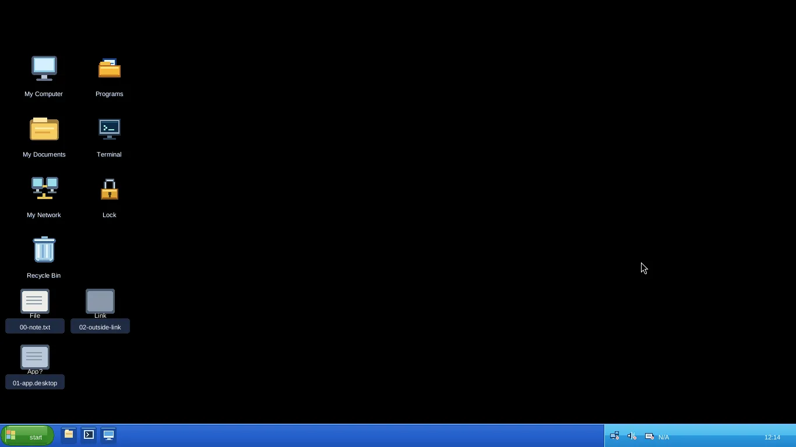](luna-file-desktop-before-20261114.webp) | [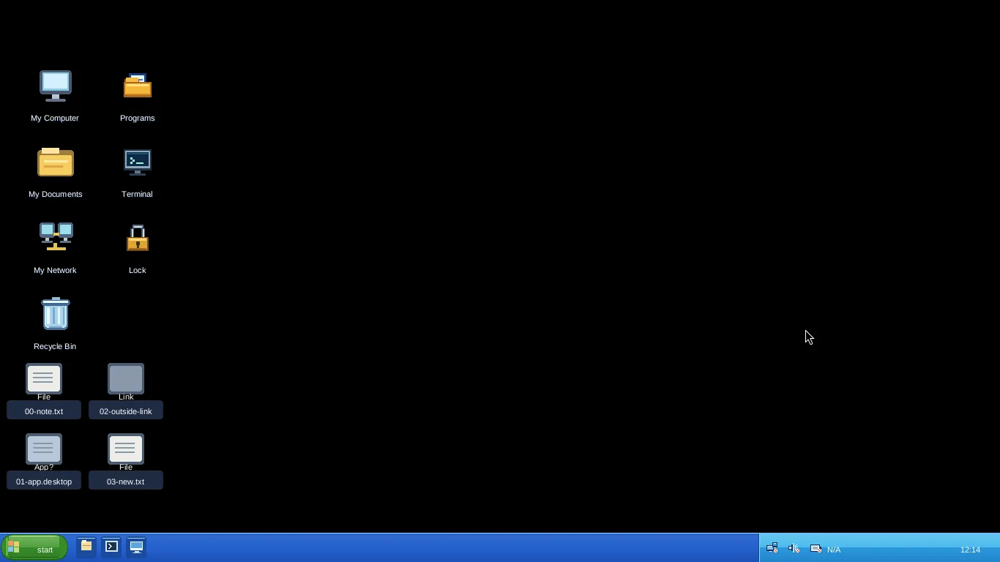](luna-file-desktop-live-20261114.webp) |

| Real compositor pointer-selected file | Dynamically added real folder |
| :---: | :---: |
| [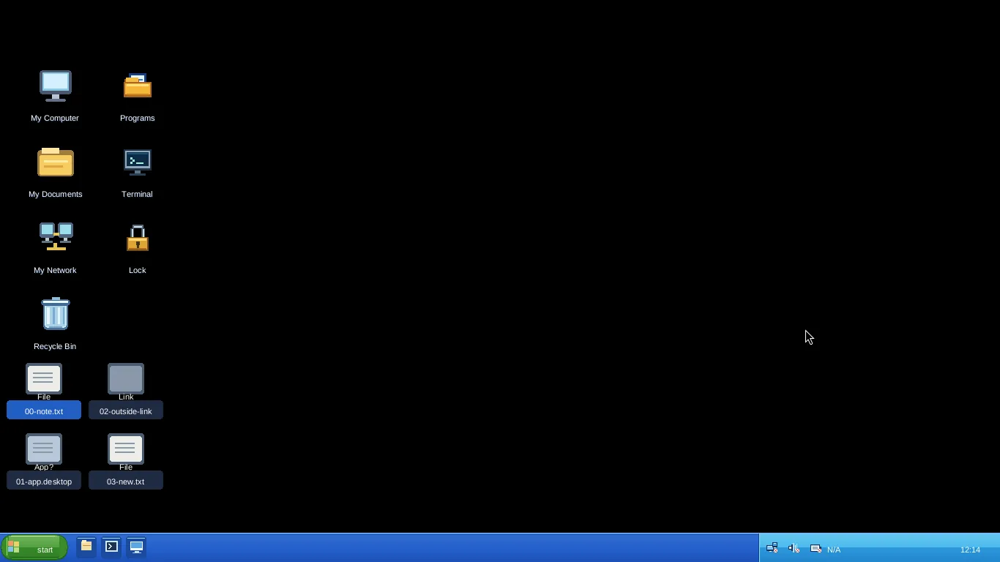](luna-file-desktop-selected-20261114.webp) | [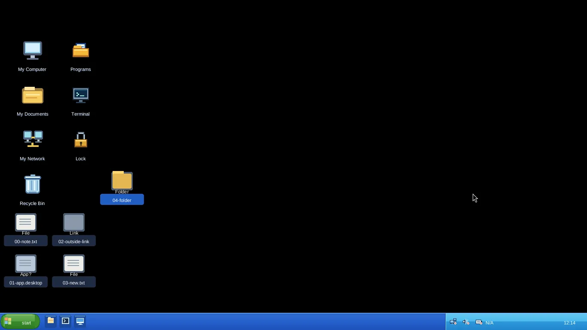](luna-file-desktop-folder-20261114.webp) |

The native smoke verifies double-click and keyboard activation, actual file additions and removal, and the RiceField folder opener's **exact command arguments**. The file manager is substituted by an isolated argv-recording shim during these captures: **the screenshots do not show a real RiceField window**. Dangerous `.desktop` launchers and symlinks remain non-executable. There is no physical Mint/GPU/IME sign-off.

[Source/preview SHA-256 provenance](luna-file-desktop-provenance-20261114.json) records all source PNG hashes, WebP hashes, source commit, frame size and measured pixel changes. The screenshots were converted to WebP without drawing additional UI elements.

## XP Luna · Sprint 3: Visuelle Fidelity 2.0 (13 November 2026)

Source: successful [Native RicePlate CI run #43384733571](https://github.com/CopyPasteUser/Ricebowl/actions/runs/43384733571),
on verified commit
[2d5ba729](https://github.com/CopyPasteUser/Ricebowl/commit/2d5ba729cf24fe0a9d5d05177325acd9bb215a60),
the code under review in [Sprint 3 PR #338](https://github.com/CopyPasteUser/Ricebowl/pull/338).
The matching [Tests #43384739750](https://github.com/CopyPasteUser/Ricebowl/actions/runs/43384739750)
and [Wayland session preview #43384739847](https://github.com/CopyPasteUser/Ricebowl/actions/runs/43384739847)
also passed. Each preview links to its checked-in WebP.

The updated set highlights the unselected desktop icon label shadow, the
native two-column Start menu and more faithful labwc titlebar. All captures
are real compositor output; no generated/mock screenshot is mixed in.

| Desktop and taskbar | Two-column Start menu |
| :---: | :---: |
| [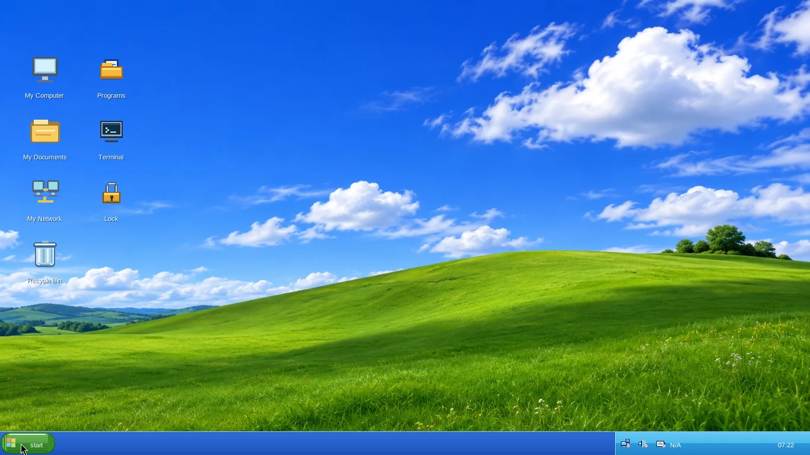](luna-desktop-20261113.webp) | [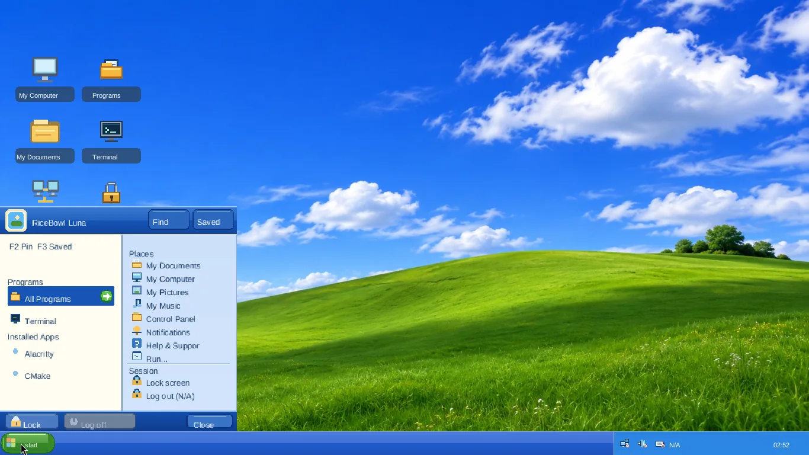](luna-start-20261113.webp) |

| All Programs · pointer navigation | Taskbar calendar |
| :---: | :---: |
| [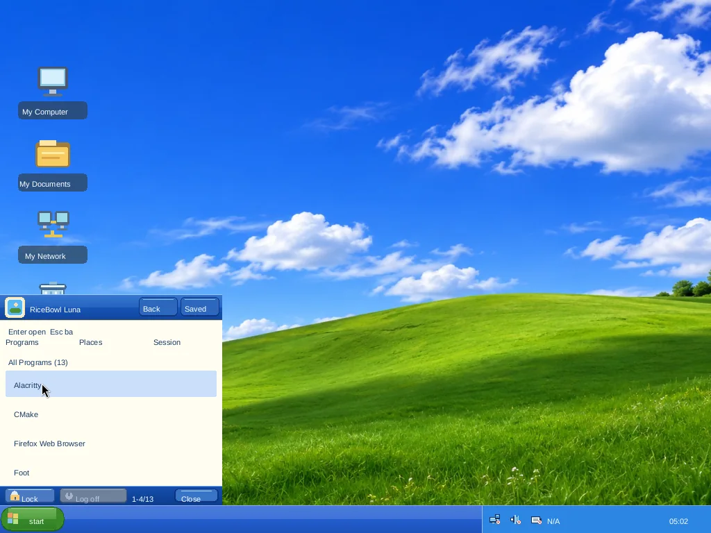](luna-all-programs-20261113.webp) | [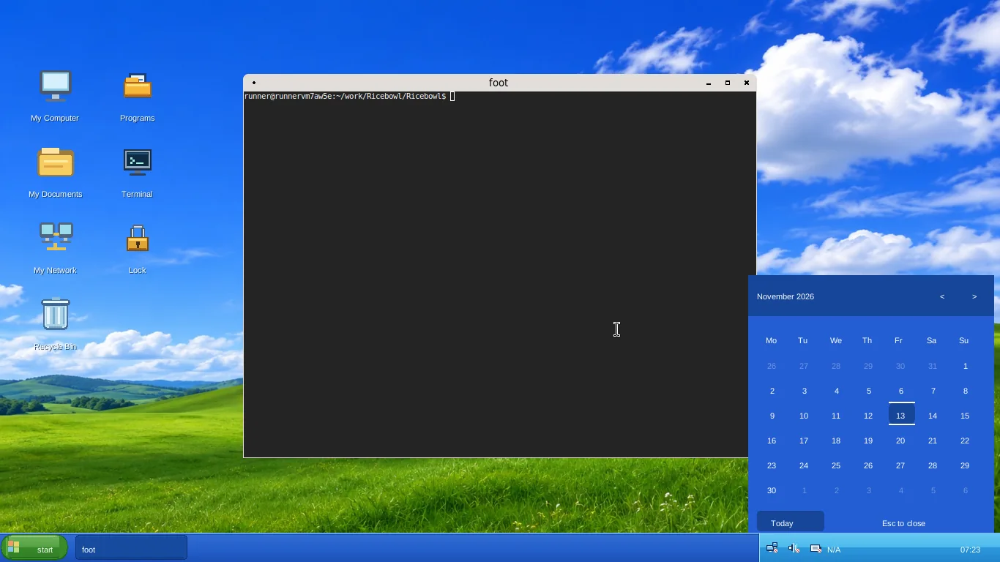](luna-calendar-20261113.webp) |

| Desktop shortcut context menu | Shortcut properties |
| :---: | :---: |
| [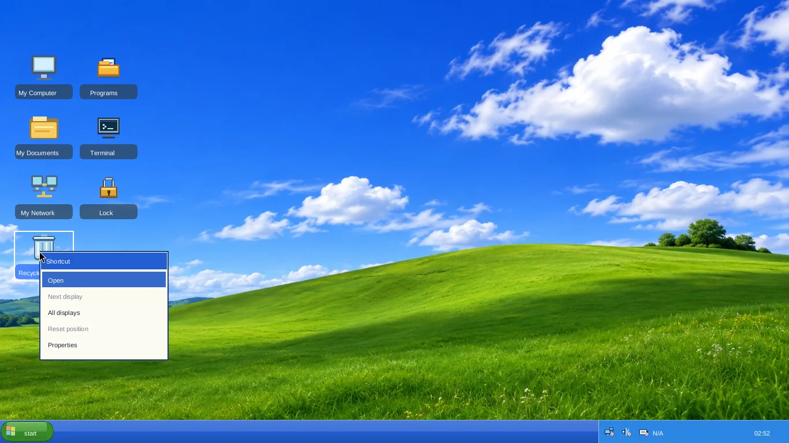](luna-context-20261113.webp) | [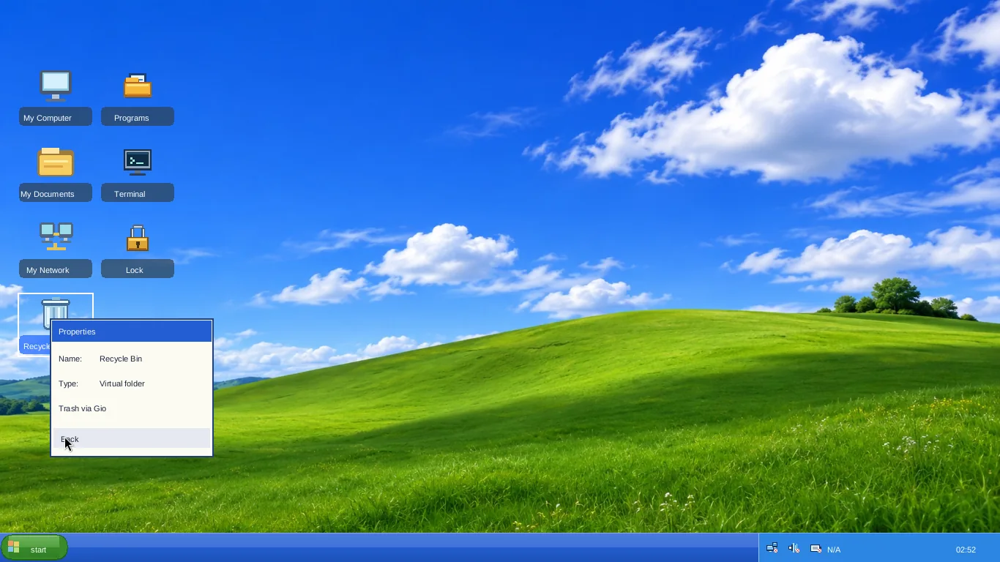](luna-properties-20261113.webp) |

| Help & Support | Run dialog |
| :---: | :---: |
| [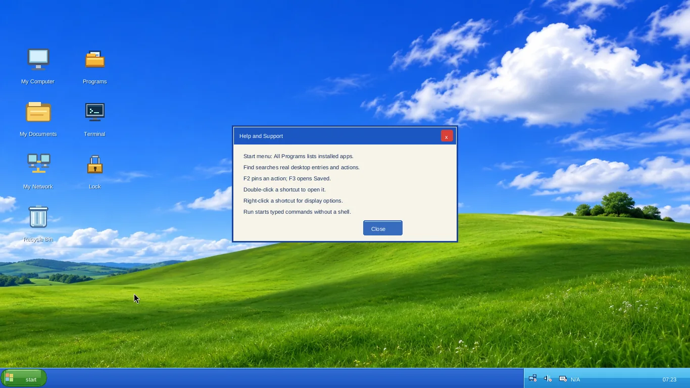](luna-help-20261113.webp) | [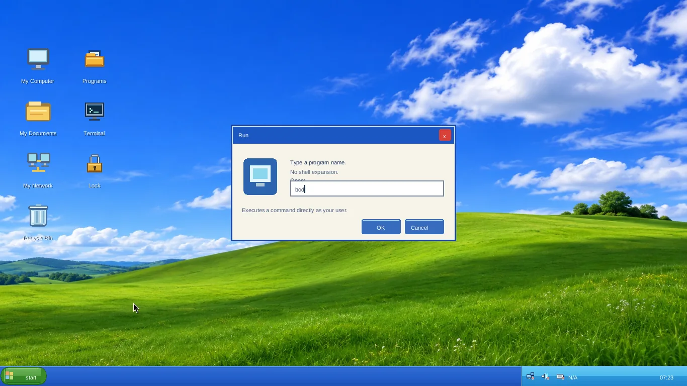](luna-run-20261113.webp) |

| XP Luna 2.0 · actual labwc window titlebar |
| :---: |
| [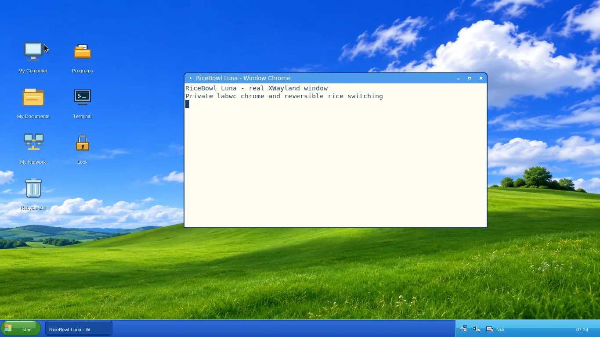](luna-titlebar-20261113.webp) |

The [provenance record](luna-gallery-provenance-20261113.json) pins every
original PNG filename, exact source commit, CI run, framebuffer dimensions,
SHA-256 of the source and SHA-256 of the published WebP. All nine previews
come from [the verified-artifact importer](../../scripts/import_native_wayland_gallery.py).
No desktop element was added or painted after capture. Existing WebP
URLs were retained and the titlebar view is new.

The earlier [first fidelity pass PR #335](https://github.com/CopyPasteUser/Ricebowl/pull/335)
has already been merged; Sprint 3 continues that work in native RicePlate.
These images show the verified Sprint 3 source commit, **not** hardware QA.

## Native input interactions

| Find after pointer click | Saved after context-menu pin |
| :---: | :---: |
| [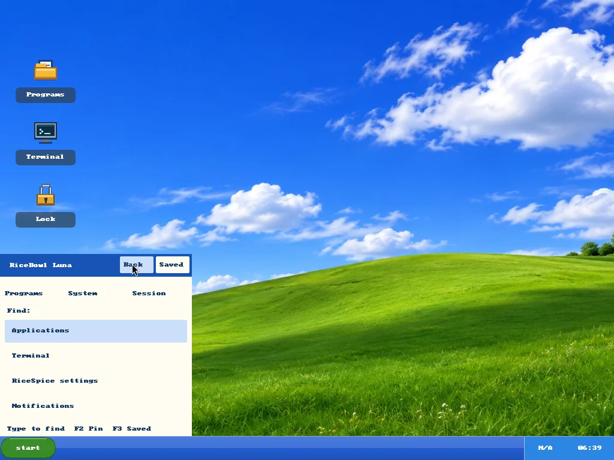](luna-pointer-find.webp) | [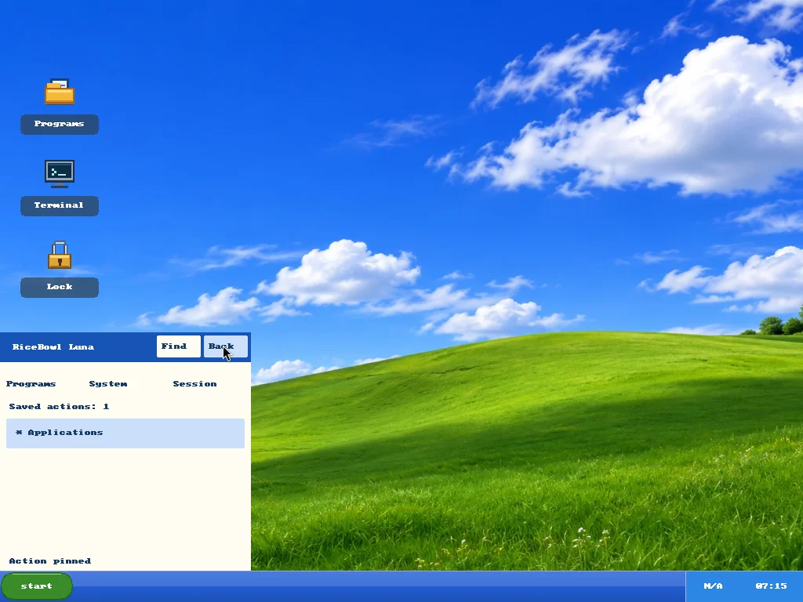](luna-saved-pinned-rightclick.webp) |

Source: [Find/Back CI #42973287104](https://github.com/CopyPasteUser/Ricebowl/actions/runs/42973287104) ·
[Pin/unpin CI #42977523704](https://github.com/CopyPasteUser/Ricebowl/actions/runs/42977523704).
These are earlier tested interactions, not captures from the gallery revision.

## Resolution, scaling and window frames

| 1024×768 | 1920×1080 | 125% output scale |
| :---: | :---: | :---: |
|  | [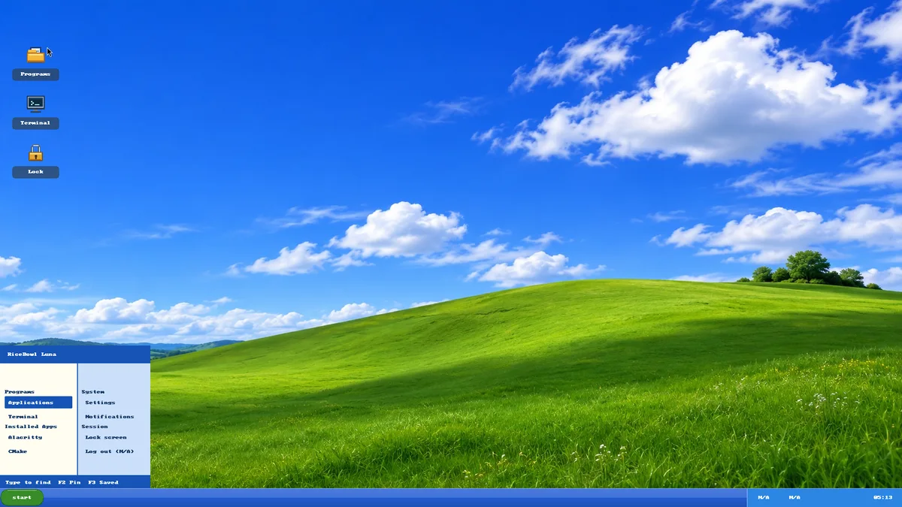](luna-live-fullhd.webp) | [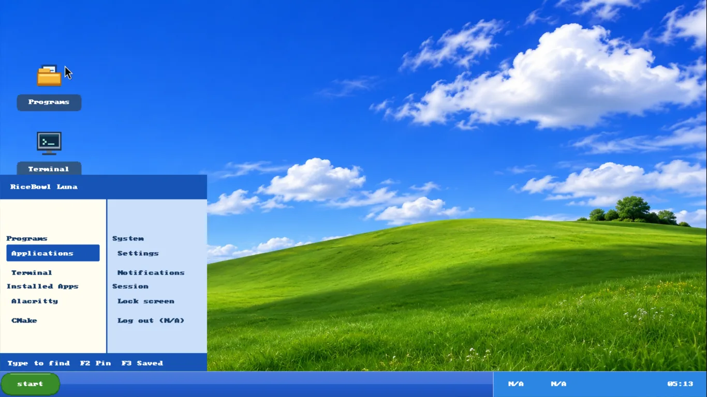](luna-live-scale125.webp) |

[Live output reconfiguration CI #42963768429](https://github.com/CopyPasteUser/Ricebowl/actions/runs/42963768429).
The Full HD preview is downscaled for viewing; original PNGs are in its
CI artifact. This does not establish mixed-DPI hardware support.

| Default XWayland frame | Optional Luna-colored frame |
| :---: | :---: |
| [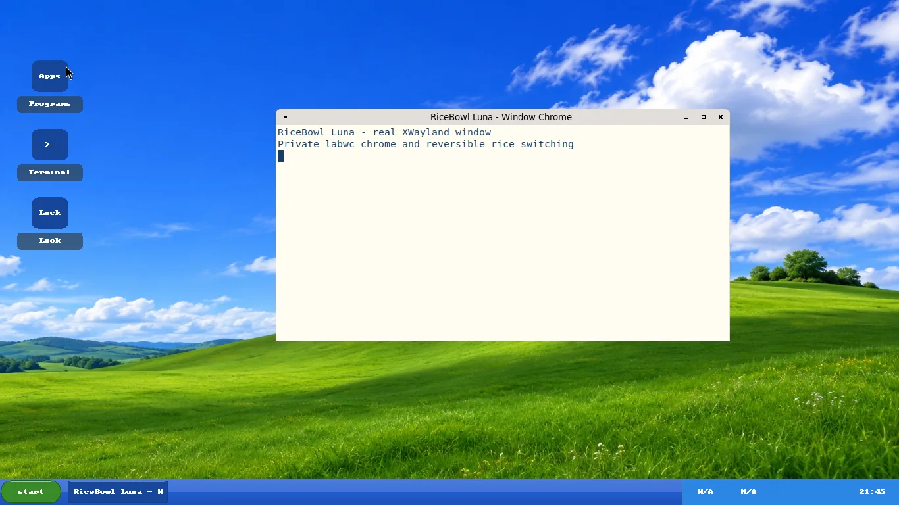](luna-window-default.webp) | [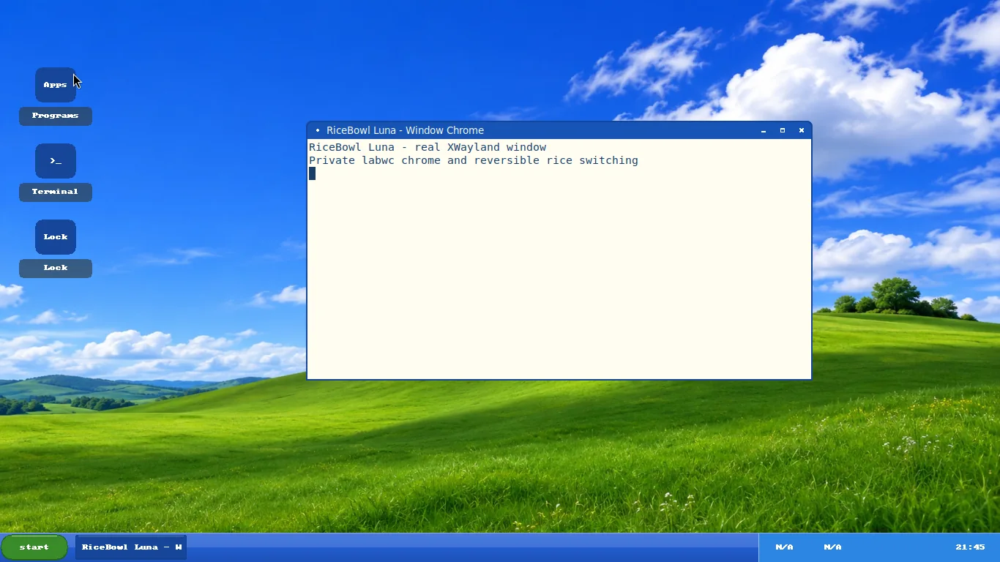](luna-window-chrome.webp) |

[Window chrome CI #42907311728](https://github.com/CopyPasteUser/Ricebowl/actions/runs/42907311728).
This only covers tested server-side decorations, not arbitrary client-side
decorated windows.

## Other experimental Wayland compositions

| Orbit Studio | Heritage Modern |
| :---: | :---: |
| [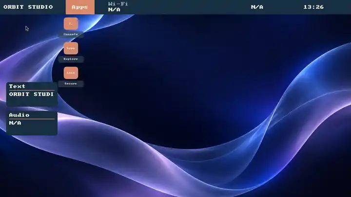](orbit.webp) | [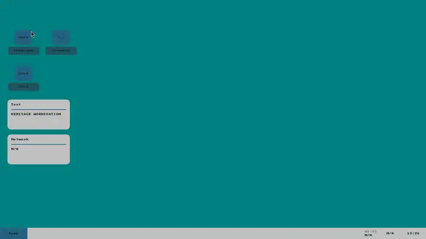](heritage.webp) |

Source: [creator example CI #42625109733](https://github.com/CopyPasteUser/Ricebowl/actions/runs/42625109733).

## Settings screenshots and capture limits

The separate GTK3 Control Panel client has genuine Xvfb screenshots in
[Tests CI #43368674304](https://github.com/CopyPasteUser/Ricebowl/actions/runs/43368674304),
including luna-control-panel-home.png and luna-control-panel-taskbar.png.
The keyboard-search version also produced luna-control-panel-search.png in
[Tests CI #43375407093](https://github.com/CopyPasteUser/Ricebowl/actions/runs/43375407093).
They are **GTK/Xvfb screenshots, not native labwc compositor captures**.

Headless CI cannot confirm physical trackpad/keyboard input, real GPU
rendering, Wayland login, audio/network hardware, suspend/resume,
accessibility or pixel-perfect XP parity. For a capture of your own running
Wayland session use the capture script with grim installed:

    scripts/capture_wayland_panel.sh /absolute/new-capture.png

Existing files are never overwritten.

See the [native CI workflow](../../.github/workflows/riceplate-native.yml),
[engineering progress](../../WAYLAND_PROGRESS.md) and
[release gates](../../RELEASE_1_0_GATES.md).
