# RiceBowl · Wayland screenshots

[← Wayland overview](../../WAYLAND_PROGRESS.md) · [Desktop status](../../DESKTOP_ENVIRONMENT_STATUS.md) · [Native capture workflow](../../.github/workflows/riceplate-native.yml)

**Real headless labwc/RicePlate renders — not mockups or screenshots of a signed-off physical desktop.** These optimized WebP previews are permanently stored in this repository, not linked from a temporary CI artifact. Select an image to view it directly.

## Luna chrome and responsive Start menu · 11 November 2026

| Native desktop at 1366×768 | Native opened Start menu at 1366×768 |
| :---: | :---: |
| [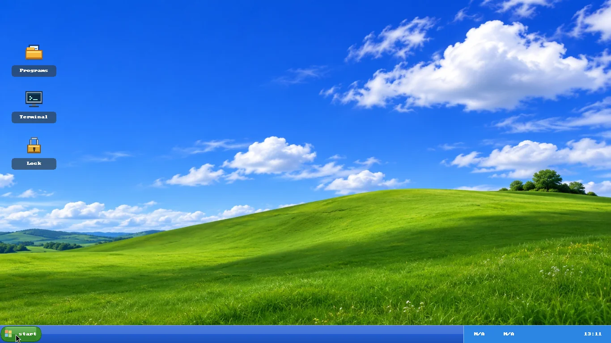](luna-fidelity-desktop-20261111.webp) | [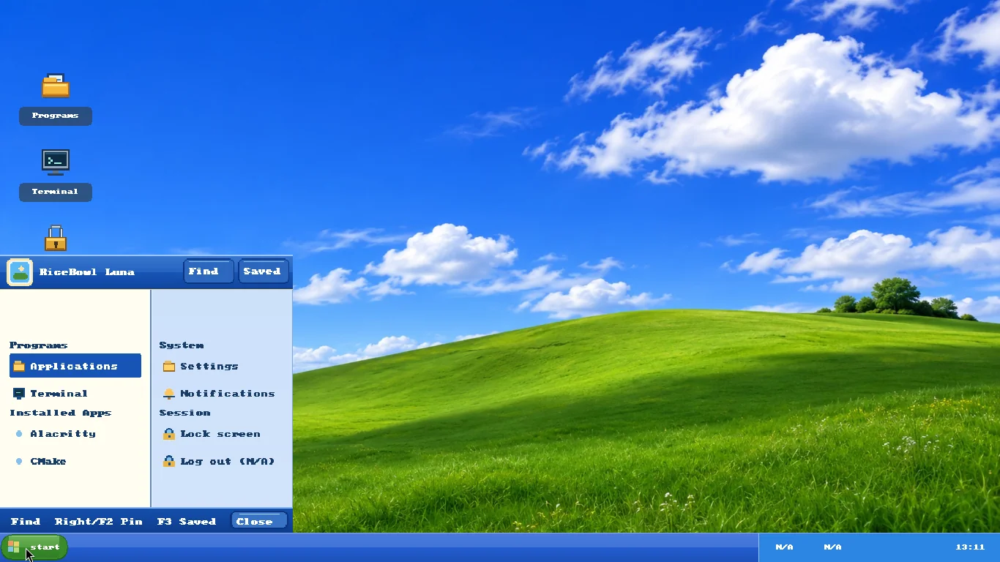](luna-fidelity-menu-20261111.webp) |
| Same running Wayland session before opening Start | Native menu after a compositor-delivered pointer click |

These are optimized, full-size copies of `xp-luna-columns-1366x768.png` and
`xp-luna-columns-menu-1366x768.png` from the [successful native PR #282 CI run](https://github.com/CopyPasteUser/Ricebowl/actions/runs/43026159262).
The test also passed menu-open pixel checks at 1024×768, 1920×1080 and 125%
scale **after live output reconfiguration**. These frames predate the later
compact network/speaker-tray polish. They demonstrate actual Wayland rendering,
not visual parity with the historical Windows XP shell.

## XP Luna · native two-column Start menu

| Desktop with original Luna hills | Opened native Start menu |
| :---: | :---: |
| [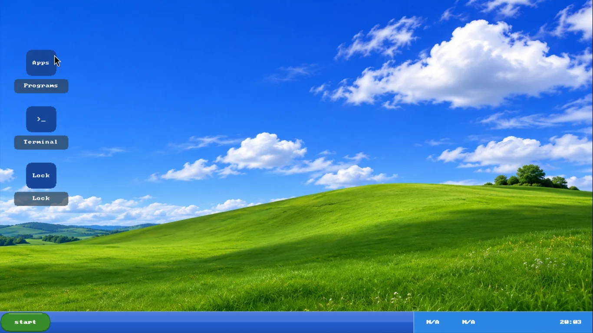](luna-desktop.webp) | [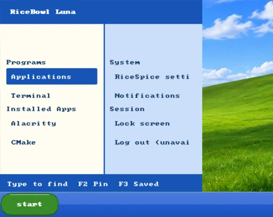](luna-menu.webp) |
| Full 1366×768 compositor capture | Readability crop from an actual 1366×768 compositor capture |

`xp-luna-columns` is an **opt-in successor**, not a replacement of existing
`xp-luna` imports. The native RicePlate panel/menu and the separate `swaybg`
wallpaper process were rendered together by headless labwc. The menu is truly
open in the second capture; it is not composited onto an image afterwards.

Sources (10 November 2026): the desktop image comes from [native capture run #42890753472](https://github.com/CopyPasteUser/Ricebowl/actions/runs/42890753472), `xp-luna-columns.png`. The updated menu image comes from [native capture run #42898859348](https://github.com/CopyPasteUser/Ricebowl/actions/runs/42898859348), `xp-luna-columns-menu.png`, which verifies readable `Settings` and `Log out (N/A)` labels in the right shelf. Both permanent WebP files are derived directly from real headless compositor captures, not mockups. Hardware status widgets may read `N/A`; this is expected in a virtual headless session. **Physical ThinkPad input, scaling, power and session acceptance remain open.**

### Original Luna desktop icons · verified before/after (11 November 2026)

| Existing RicePlate shortcuts | Original Luna icon family |
| :---: | :---: |
|  | [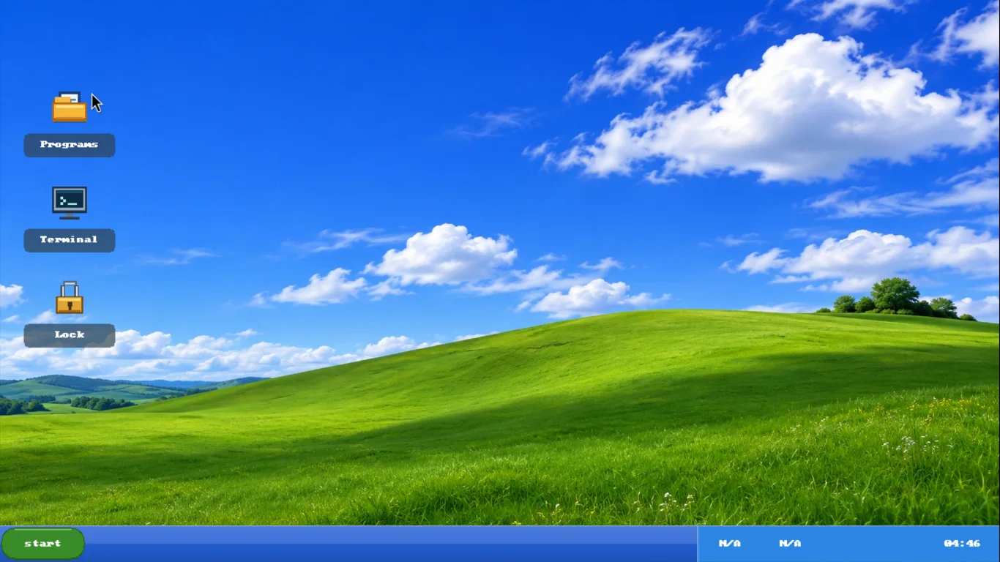](luna-icons-after.webp) |
| `artwork.icons: builtin` | `artwork.icons: builtin-luna` |

All three 1366×768 frames are optimized from **real headless labwc PNGs**
(`xp-luna-default-icons.png`, `xp-luna-columns.png` and
`xp-luna-columns-menu.png`) archived by [green native run #42960890682](https://github.com/CopyPasteUser/Ricebowl/actions/runs/42960890682)
for [PR #239](https://github.com/CopyPasteUser/Ricebowl/pull/239).
The screenshot test changes *only* the desktop icon choice in an otherwise
identical recipe, then requires more than 600 changed RGB pixels inside an
actual icon's 48×48 compositor region. The pictograms are drawn directly by
the native Rust RicePlate code, not supplied by third-party icon packs or
Windows artwork. The labels and wallpaper are unchanged; headless hardware
widgets may display `N/A`. Physical hardware acceptance remains pending.

### Luna live output matrix · 1024×768, Full HD and 125% scale (11 November 2026)

| 1024×768 at 100% | 1920×1080 at 100% | 1366×768 at 125% |
| :---: | :---: | :---: |
|  |  |  |
| Original 1024×768 capture | Original 1920×1080 capture, preview downsampled to 1200×675 | Original 1366×768 capture |

The **same running native RicePlate process** was exercised while labwc
switched between 1024×768, 1366×768, 1920×1080 and 1366×768 at 125%.
The smoke test first restores the output to 100% after unrelated scaling QA;
it then captures the actual compositor with the menu both closed and open at
each geometry. CI checks real screenshot dimensions, the `swaybg` wallpaper,
the taskbar pixels and an opened-menu pixel delta over 10,000. The three
optimized WebPs above are directly derived from unaltered PNG frames in
[successful native CI run #42963768429](https://github.com/CopyPasteUser/Ricebowl/actions/runs/42963768429)
(`xp-luna-columns-menu-1024x768.png`,
`xp-luna-columns-menu-1920x1080.png` and
`xp-luna-columns-menu-scale-125.png`). The full-resolution originals and all
eight captures remain in that run's artifact.

At Full HD the fixed-size Start menu is noticeably compact. This matrix
verifies compositing and geometric visibility, **not** font-size/accessibility
quality or physical mixed-DPI, touch, pointer, focus and monitor hotplug.

### Luna visual review · actual opened-menu difference maps

| 1024×768 · 100% | 1366×768 · 125% |
| :---: | :---: |
|  |  |
| 93,748 pixels changed beyond RGB threshold 24 | 146,330 pixels changed beyond RGB threshold 24 |

These are **real pixel-difference maps** between the corresponding closed
and open Start-menu PNGs from [native run #42963768429](https://github.com/CopyPasteUser/Ricebowl/actions/runs/42963768429),
made with RiceBowl's existing offline `compare_wayland_captures.py` tool.
Red indicates a pixel difference; black indicates no change. The full-width
panel is not painted red because opening the menu does not repaint it. The
native CI pipeline now runs that same comparison for **all four geometries**,
archives the full-resolution heatmaps and a structured, SHA-256-attributed
`luna-menu-visual-review.json` containing panel, desktop and icon diagnostics.
The result verifies a compositor-visible state change in the expected area;
it does **not** certify interactive hit targets, screenshot fidelity to
Windows XP, accessibility or hardware performance.

### Luna Start button · real Wayland pointer click (11 November 2026)

| After first native Start click | After second native Start click |
| :---: | :---: |
| [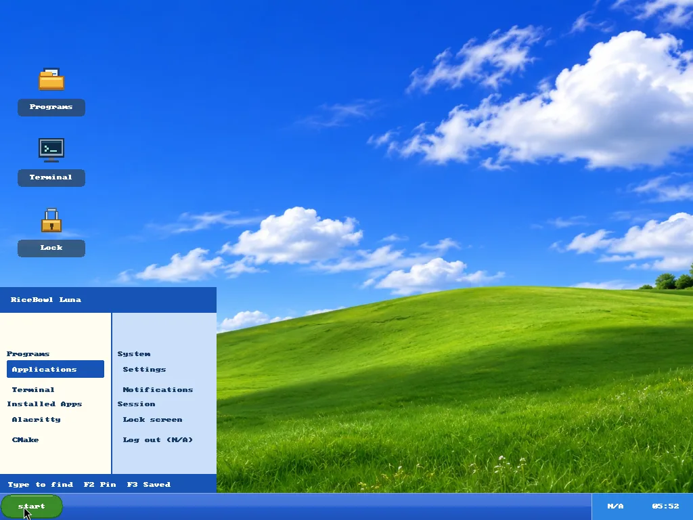](luna-pointer-open.webp) | [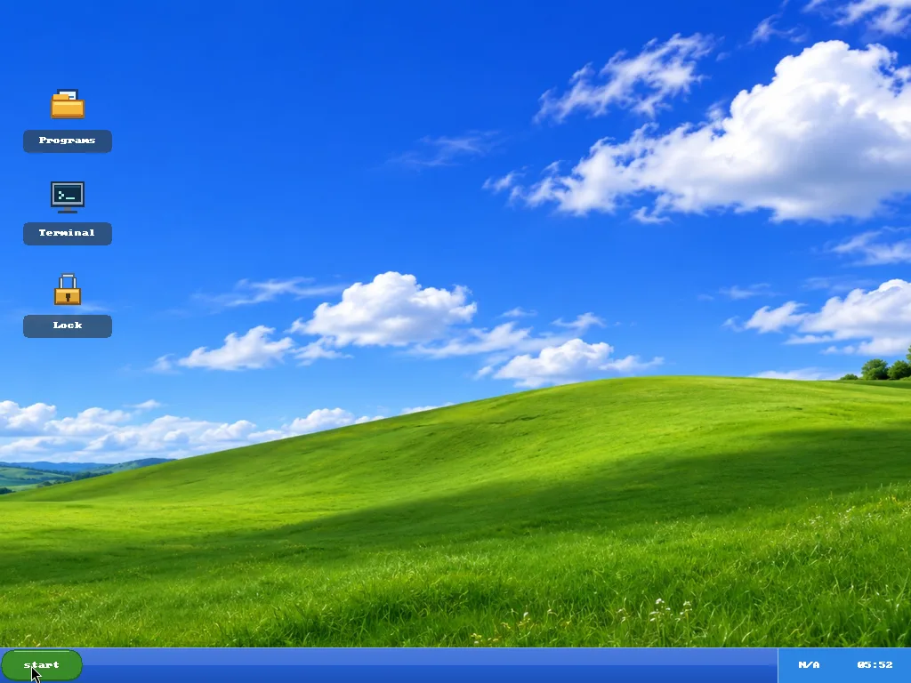](luna-pointer-closed.webp) |
| Actual menu opened by compositor input | Actual menu dismissed and desktop restored |

Both full 1024×768 WebPs are optimized from **genuine headless labwc
captures** (`xp-luna-pointer-open-1024x768.png` and
`xp-luna-pointer-closed-1024x768.png`) produced in
[successful native run #42968039762](https://github.com/CopyPasteUser/Ricebowl/actions/runs/42968039762)
for [PR #247](https://github.com/CopyPasteUser/Ricebowl/pull/247).
Unlike a `--preview-menu` screenshot, these frames follow actual
`zwlr_virtual_pointer` motion, press and release events delivered through
the compositor to the native green Start button. CI verifies the opened menu
changes more than 10,000 pixels and the second click restores the original
desktop within 5,000 pixels, including live reconfiguration at Full HD and
125% scale. All six unmodified PNGs remain in the run artifact. Input was
isolated to the throwaway CI compositor; **real ThinkPad mouse, keyboard,
touch, focus and accessibility acceptance remain open**.

### Native Find and Saved · actual pointer interaction

| Find view · clicked native header | Saved view · clicked native header |
| :---: | :---: |
|  |  |
| Find results, with a real compositor pointer | Explicit empty Saved state, with Back |

The CI-only virtual-pointer client now exercises the *visible header controls*
of the running Luna menu, after opening it with a real Start click at 1024×768:

1. Click **Find**, capture the native search state, then click **Back**.
2. Click **Saved**, capture the saved-action state, then click **Back**.
3. Capture the restored open menu before closing it with Start.

The native workflow archives the unmodified compositor PNGs
`xp-luna-pointer-{open,find,saved,return}-1024x768.png` and checks that both
views visibly differ from the ordinary menu and each other while the final
menu matches the starting view. This covers real labwc input routing, menu
painting and state transitions; it does not certify a physical mouse, touchpad,
Orca or the appearance of a populated user-specific Saved list.

The two permanent 1024×768 WebP images above were converted from unmodified
PNG compositor frames in [successful native run #42973287104](https://github.com/CopyPasteUser/Ricebowl/actions/runs/42973287104)
for [merged PR #254](https://github.com/CopyPasteUser/Ricebowl/pull/254).
The CI test checks distinct interactive states and a restored baseline; the
WebPs are **not rendered mockups** or evidence of physical-device acceptance.

A second compositor test sends an actual `zwlr_virtual_pointer` vertical
wheel-axis event over the Find result list. The additional
`xp-luna-pointer-find-paged-1024x768.png` must differ from the separate
`find-hover` frame at the **same pointer position**: a mere hover selection
cannot pass as paging. This exercises the native event/render path. It is
an isolated virtual-device check; touchpad inertia and physical input remain
for separate hardware acceptance.

| Find list before wheel axis | Same pointer location after real vertical axis |
| :---: | :---: |
|  |  |
| First results visible | Later results visible; no pointer movement |

These two permanent, full-size 1024×768 WebPs were converted from unmodified
compositor screenshots in [successful native run #42974656672](https://github.com/CopyPasteUser/Ricebowl/actions/runs/42974656672)
for [merged PR #256](https://github.com/CopyPasteUser/Ricebowl/pull/256).
The native test uses the **same cursor coordinates** before and after a real
Wayland vertical wheel-axis request and requires more than 1,200 differing
pixels. Both snapshots come from headless labwc; they establish compositor
input and visual paging, not physical touchpad acceptance.

### Luna page range · actual post-scroll counter

This permanent full-resolution WebP comes from the unmodified
`xp-luna-pointer-find-paged-1024x768.png` compositor frame in
[successful native run #42975969150](https://github.com/CopyPasteUser/Ricebowl/actions/runs/42975969150)
for [merged PR #258](https://github.com/CopyPasteUser/Ricebowl/pull/258).
The footer reports `5-6/6` after genuine wheel paging; this is the same
native view and test path as the previous frames, now with an explicit visible
row-range cue. The screenshot proves the rendered counter in headless labwc,
not hardware scroll-wheel or assistive-technology acceptance.

### Luna Saved actions · real right-click pin and remove

| Right-clicked Find action, then opened Saved | Right-clicked saved action to remove it |
| :---: | :---: |
|  | [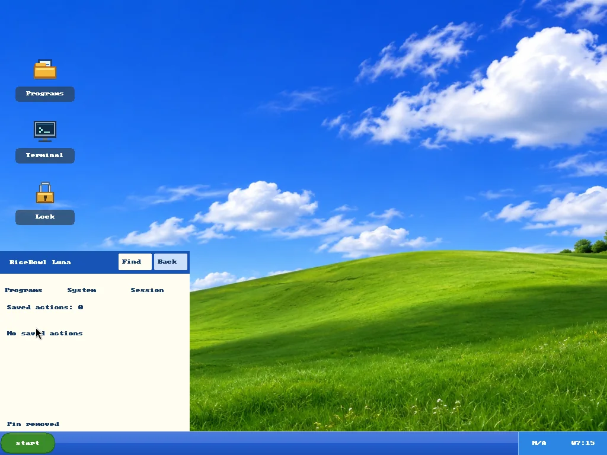](luna-saved-unpinned-rightclick.webp) |
| `Saved actions: 1`, `* Applications` | `Saved actions: 0`, `No saved actions` |

Both 1024×768 WebPs are optimized directly from unmodified headless labwc
PNG captures `xp-luna-pointer-saved-{pinned,unpinned}-1024x768.png` in
[successful native run #42977523704](https://github.com/CopyPasteUser/Ricebowl/actions/runs/42977523704)
for [PR #263](https://github.com/CopyPasteUser/Ricebowl/pull/263).
The CI-only virtual pointer emits actual right-button press/release input.
The smoke test verifies a populated Saved row and restoration of the empty
view using screenshot pixel assertions; the original full-size PNGs remain
in the CI artifact. This is real compositor interaction, but it does not
replace physical mouse or accessibility acceptance.

### Opt-in portable font · real compositor comparison

| Bundled bitmap font | Imported private TrueType font |
| :---: | :---: |
|  | [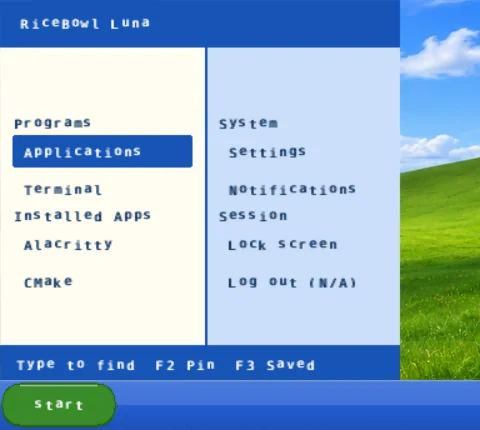](luna-font.webp) |
| Default `xp-luna-columns` | Temporary `xp-luna-font-preview` |

The right capture is a **real native RicePlate rendering** in headless labwc
from [successful native CI run #42904147986](https://github.com/CopyPasteUser/Ricebowl/actions/runs/42904147986),
`xp-luna-font-menu.png`, cropped for readability. CI imports a redistributable
DejaVu Sans Mono test font into an isolated, owner-private directory, references
its content-addressed ID from a temporary recipe and compares both real
framebuffers. No font is installed globally, and existing rices retain their
selected font. Complex shaping, toolkit-wide fonts and physical-DPI acceptance
are outside this verified feature.

### Luna calendar · native popup font comparison

| Original bitmap calendar | Owner-private DejaVu TrueType calendar |
| :---: | :---: |
| [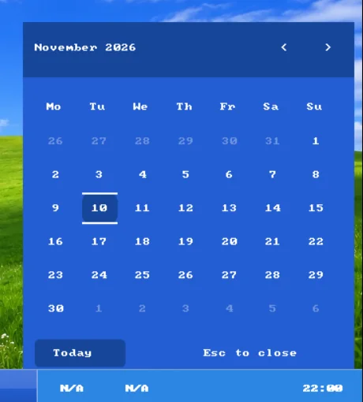](luna-calendar-default.webp) |  |
| Default `xp-luna-columns` | Temporary `xp-luna-font-preview` |

Both crops are taken from **real 1366×768 headless labwc compositor frames**
in [successful native CI run #42909714051](https://github.com/CopyPasteUser/Ricebowl/actions/runs/42909714051):
`xp-luna-columns-calendar.png` and `xp-luna-font-calendar.png`. CI opens the
native calendar popup for each recipe and verifies a visible difference inside
the calendar surface. The imported font also reaches the native volume OSD;
its own compositor proof is documented immediately below.
The original bitmap calendar pixels remain the fallback when no private face
is selected. CI uses an owner-private test asset; no global font configuration
or existing rice is modified. These previews do not replace physical display,
keyboard and accessibility acceptance.

### Luna volume OSD · real compositor comparison

| Original bitmap volume overlay | Private TrueType volume overlay |
| :---: | :---: |
|  |  |
| Default `xp-luna-columns` | Temporary `xp-luna-font-preview` |

Real **1366×768 headless labwc/RicePlate screenshots**, cropped around the
actual overlay, from [successful native CI run #42914562690](https://github.com/CopyPasteUser/Ricebowl/actions/runs/42914562690):
`xp-luna-columns-osd.png` and `xp-luna-font-osd.png`. The explicit
`--preview-osd` mode paints a deterministic **simulated** 68% notice into
the real, input-transparent Wayland overlay; it never changes the system
volume. The normal volume overlay still expires after 1.8 seconds. This
capture's 125%-scaled output places the 248×70 logical surface across about
310×88 physical pixels. A full overlay comparison detects **880 changed
RGB pixels**, whereas a crop assuming 100% scale missed its left-hand text.
The proof covers rendering, not hardware mixer events or physical focus.

### Luna RicePop · native notification font captures

Four **real 1366×768 headless labwc framebuffer screenshots** are archived
in [successful native run #42970768749](https://github.com/CopyPasteUser/Ricebowl/actions/runs/42970768749)
(the `riceplate-native-preview` artifact):

| Notification surface | Bundled bitmap | Owner-private TrueType |
| --- | --- | --- |
| Active list | `xp-luna-columns-notifications.png` | `xp-luna-font-notifications.png` |
| Message detail | `xp-luna-columns-notification-detail.png` | `xp-luna-font-notification-detail.png` |

These are CI-only, simulated notifications painted by the **actual native
RicePlate popup**, not images assembled from a static mockup. A deterministic
preview does not query, dismiss or change the host's Mako notifications.
The CI checks each popup visibly alters the closed desktop by more than 2,500
RGB pixels and that the imported font changes more than 250 pixels in both
the list and the message detail. Without an imported font, legacy bitmap
painting stays unchanged. The compact-popup and 200% font wrapping/page
behavior have Rust regression tests; physical screen-reader and focus QA
remain deferred. These four PNGs are in the expiring run artifact rather than
checked-in permanent WebP gallery images.

### Luna window chrome · real XWayland before/after

| Default labwc server-side window frame | Private Luna palette-driven frame |
| :---: | :---: |
|  |  |
| Existing tabs/sidebar and unthemed recipes | Opt-in two-column Luna recipe |

Both full 1366×768 WebP files originate from the **same real headless
compositor session** in [successful native CI run #42907311728](https://github.com/CopyPasteUser/Ricebowl/actions/runs/42907311728),
`xp-luna-window-default.png` and `xp-luna-window-chrome.png`. CI boots labwc,
native RicePlate, original `swaybg` wallpaper and a genuine XWayland `xterm`,
then applies `themerc-override` only inside a temporary, owner-private config
directory. A real labwc reload changes **19,980 pixels inside the window
region** in this run; the test deliberately excludes the panel clock and
surrounding wallpaper. The photos are **not mockups**.
Third-party GTK/Qt client-side decorations do not necessarily follow this
server-side theme; focus, moving, resizing and mixed-DPI remain unaccepted on
physical hardware.

## Two different desktop compositions

| Orbit Studio | Heritage Modern |
| :---: | :---: |
|  |  |
| Original, dark, top-oriented layout | Classic, light, bottom-oriented layout |

## Native shell surfaces

| Native workspace | Native menu |
| :---: | :---: |
| [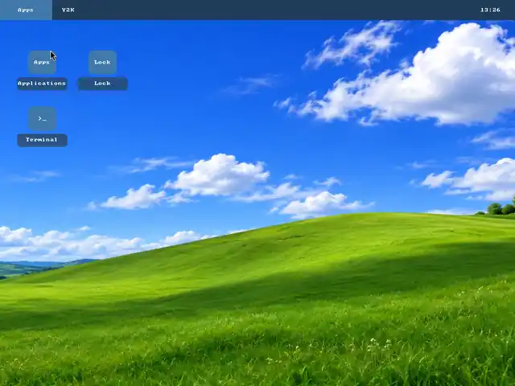](workspace.webp) | [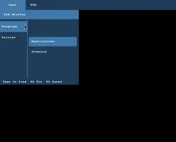](menu.webp) |
| Native compositor framebuffer | Real native menu, cropped to show the important area |

## Where the images came from

Source: [Successful GitHub Actions run #42625109733](https://github.com/CopyPasteUser/Ricebowl/actions/runs/42625109733), commit [`8001a0a`](https://github.com/CopyPasteUser/Ricebowl/commit/8001a0a24db469358f420cc82a8ccaf4522b26c6), 9 November 2026. These are resized/compressed copies of the captured PNGs:

| File in this folder | PNG in CI artifact |
| --- | --- |
| `orbit.webp` | `creator-examples/orbit-studio-v10-1366x768-scale-1-0.png` |
| `heritage.webp` | `creator-examples/heritage-modern-v10-1366x768-scale-1-0.png` |
| `workspace.webp` | `isolated-v5.png` |
| `menu.webp` | `menu-sidebar-v6.png` (cropped) |

The full-resolution source images and SHA-256 manifests are in the run artifact while its retention period lasts. Hardware-dependent widgets may show `N/A`; that is honest headless state, not a connection failure on your device. The [XFCE/X11 screenshot gallery](../current/README.md) shows a different implementation.
